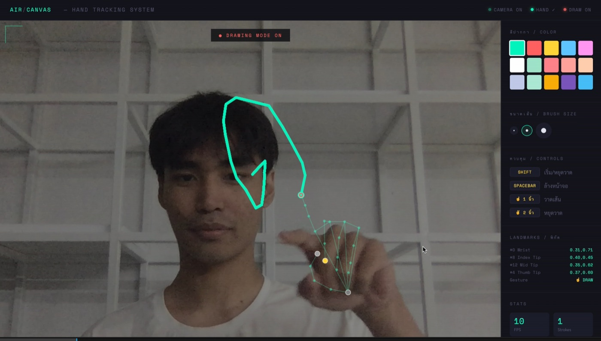
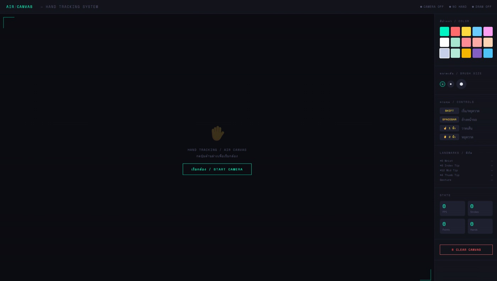
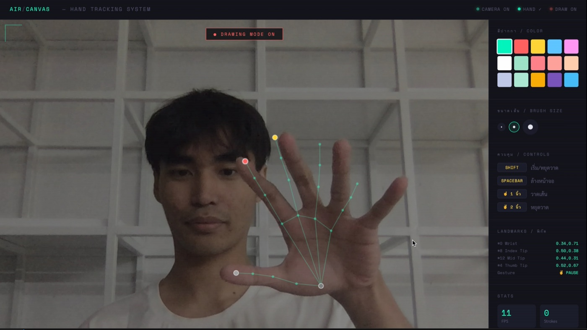

# Hand Tracking Air Canvas

A browser-based drawing prototype controlled by hand gestures through a webcam. This is a group project; the original code and its history are in [sucsage/ConOps](https://github.com/sucsage/ConOps).



## Live demo

**<https://ariyaluesawat.github.io/Hand-Tracking-Air-Canvas/>**

Open the link, select **START CAMERA**, and allow camera access. You need a webcam and a recent version of Chrome, Edge, Firefox, or Safari. Everything runs in your browser and no video is sent anywhere. The site is served by GitHub Pages from the `main` branch, so it updates after each push.

## Try it locally

Run a local web server from this directory:

```bash
python3 -m http.server 8000
```

Open <http://localhost:8000>, select **START CAMERA**, and allow camera access. The page loads MediaPipe from a CDN, so an internet connection is needed to load the hand-tracking library.

## Screenshots

| Start screen | Hand overlay |
| --- | --- |
|  |  |

These screenshots come from the group SRS (UI-101 to UI-103) and show the first prototype. The current page also has an Actions panel with draw mode, Undo, Save PNG, hide camera, and Clear.

## Controls

| Action | Control |
| --- | --- |
| Toggle drawing mode | Shift or the **เปิดโหมดวาด** (draw mode) button |
| Draw | Raise only your index finger while drawing mode is on |
| Pause the current stroke | Raise two or more fingers (a fist also pauses) |
| Undo the last stroke | Ctrl+Z / ⌘+Z or **Undo** |
| Clear the canvas | Space or **Clear** |
| Save the drawing | **Save PNG** |
| Hide or show the camera feed | **ซ่อนกล้อง** (hide camera) button |
| Change color or brush size | Use the side panel |

The interface shows hand landmarks, which fingers are raised, and live FPS, stroke, point, and hand counts. The FPS turns yellow below 15 (the SRS minimum). Drawings stay in memory for the current session and disappear when the page is refreshed, so use **Save PNG** to keep one.

## How tracking works

- The pen follows landmark #8 (index fingertip). The page maps it through the same `object-fit: cover` crop as the video, so the pen stays on the fingertip at any window size.
- A finger counts as raised when its tip is farther from the wrist than its middle joint. This also works when the hand is tilted.
- A gesture must hold for 3 frames before it changes the pen state, so one noisy frame does not break a line.
- Fingertip jitter is smoothed with a One Euro filter (Casiez et al., CHI 2012), and lines are drawn as curves through the points.

## Project document

The group [Software Requirements Specification](docs/Hand-Tracking-Air-Canvas-SRS.pdf) describes the requirements, interface, and system limitations.

## Built with

HTML, CSS, JavaScript, HTML Canvas, and MediaPipe Hands.
